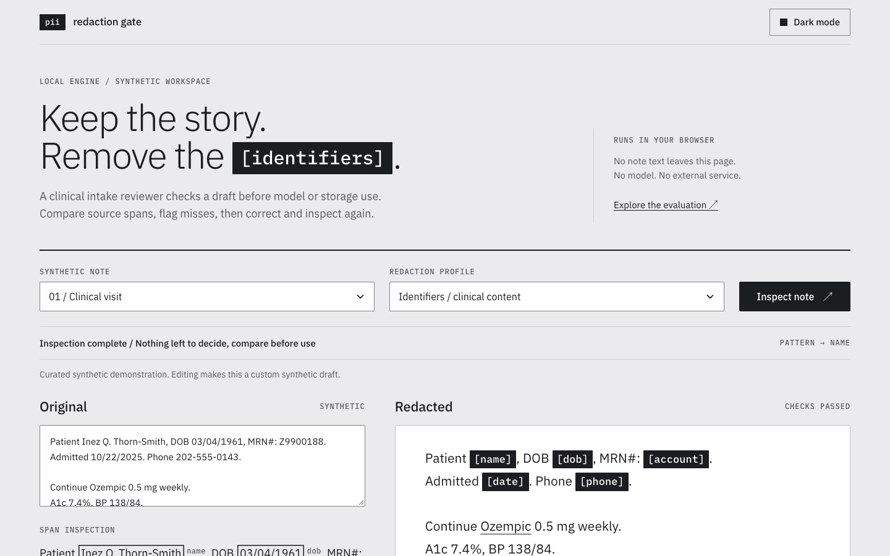

# Clinical text redaction gate

A rule-based gate for clinical free text on its way to a model prompt or a record store. It removes identifiers, keeps the clinical content (drugs, doses, labs, diagnoses), and tells you what it could not decide. Every result is one of three things:

- **clean**: every check this profile runs read the whole input and found nothing left to decide. This is not proof that no identifier remains. The result lists what was read, which checks ran, and the known gaps no check can see.
- **review**: some spans could not be decided (a word that could be a name or a term, a number that looks like a scan error, a script the rules do not read). The send guard refuses the result until a person has looked.
- **blocked**: something failed or could not be read. The output is `[redaction-blocked]` and nothing is sent.



**This is not validated de-identification.** It is a public demonstration built and tested on synthetic text and on public case reports with fictional identifiers planted in them. No real patient data was used. Do not use it as the only control for protected health information.

## Honest headline

| Test set | What it is | Result | Status of the set |
|---|---|---|---|
| Real public case reports, 9 documents, 38 planted fictional identifiers ([PR 4](https://github.com/kvmadden/pii-redaction-gate/pull/4)) | Open-access case reports with identifiers planted by a program | Untuned gate (main before this work): **20 of 38 removed (52.6%)**, an identifier left in **9 of 9** documents | The honest current measure for main |
| Same 9 documents | | This branch: 35 of 38 removed, an identifier left in 2 of 9 documents, both marked for review | Development data. Its failure list was public and its misses were read while rules changed |
| 182 synthetic snippets, 207 labeled identifiers | Written with the first release | This branch: 184 of 207 (88.9%). 184 of 195 (94.4%) without the 12 ages under 90 the policy keeps | Development data |
| 27-template development check | 27 identifier templates written 4 times each, plus 6 clinical sentences | This branch: 26 of 27 templates. The one miss is the title in "Dr. Emrys Calder", which is kept on purpose | Development data. Not held out: its vocabulary was added to a protected word list after it was committed |

No number on this page comes from a set that was written blind and locked before its first run. A fresh blind set is specified in [docs/fresh-test-spec.md](docs/fresh-test-spec.md). Until it is written, scored once and published, there is no headline accuracy figure.

Earlier versions of this README and its case page reported **104 of 108 (96.3%)** on a "held-out" set. That set is the 27-template development check above. Its 108 rows are 27 templates written four times, and its own words (Jardiance, Rheumatoid, Arthritis, Telephone, Portal and others) were added to the name tier's protected list after it was frozen. The figure is withdrawn.

## Try it

```bash
# Library
node --input-type=module -e "
import { redactText, assertSendable } from './src/index.js'
const r = redactText('Patient Inez Thorn, DOB 03/04/1961, seen at Riverside Clinic. Continue metformin 500 mg BID.', { source: 'clinical-note' })
console.log(r.text, r.status, r.review)
"

# Command line: exit 0 clean, 3 needs review, 2 blocked, 1 usage error
printf 'Patient Inez Thorn, MRN 4471023. Continue metformin.\n' | node bin/redaction-gate.js --source clinical-note

# Browser demo, local only
npm run demo   # then open http://127.0.0.1:8769
```

No install step and no dependencies with Node 22 or later. Nothing is sent over the network.

In the demo, pick a fictional note, compare the original spans with the redacted text, and read the scan report under the output: characters read, checks run, checks this profile skips, and each span that needs review with its reason. The simulated send passes a clean result, refuses a review result until "Mark as reviewed" is pressed for that exact revision, and refuses a blocked one. The failure toggle makes the engine fail at the pattern stage to show the blocked path.

## How it decides

The text runs through up to three tiers, then a residual scan reads the output again.

1. **Patterns.** Email, SSN, dates of birth, Luhn-checked cards, phones (including international and Unicode dash forms), street addresses, city with state and ZIP, coordinates. Under the clinical profiles also URLs, validated IPv4 and IPv6, MAC addresses, labeled record and plan numbers, dates in numeric, ISO, month-name and ordinal forms, and ages over 89. Dates are validated, so "2/3 weeks", "3/4 strength" and a prednisone taper stay. Every rule runs in linear time, and inputs over 2,000,000 characters block.
2. **Names.** Known names from an optional people map become role tokens (`[patient]`). Then a token classifier decides each capitalized word from evidence: titles, labels, relation words, greetings and sign-offs, facility types, initials, eponyms before a clinical head noun ("Bell palsy"), first plus last name pairs, heading runs, and finally the word's class and position. A title outranks every word list. When the evidence conflicts, the word goes to review.
3. **Topics** (standard and strict profiles only). Removes whole sentences about sensitive personal topics.
4. **Residual scan.** Undecided or name-shaped words, unlabeled long numbers and letter-digit codes, digits mixed with O, I or l, birth years without a reference date, scripts the rules do not read, invisible characters, obfuscated email, and unredacted "Name:" fields. Each becomes a review item with offsets into the output.

The name tier's vocabulary is not hand-picked. It is built by [scripts/build-lexicon.mjs](scripts/build-lexicon.mjs) from public-domain sources, each pinned by SHA-256 in [data/lexicon/manifest.json](data/lexicon/manifest.json): US Census 2010 surnames and 1990 first names, Drugs@FDA product names and ingredients, CMS ICD-10-CM 2025 descriptions, and Webster's Second International word list. A test checks that the words the old list took from the template set (Jardiance, Rheumatoid, Arthritis, Portal, Telephone) and the template names do not appear in the name-tier source, and that the public lists still classify those words.

## Profiles and sources

| Profile | Tiers | Used for |
|---|---|---|
| `identifiers` (default) | patterns with clinical rules, names with the unknown-name pass, residual scan | clinical notes, discharge summaries, referral letters, patient messages, call and voice transcripts |
| `strict` | all of the above plus topic sentences | personal email and SMS, where the topic itself is sensitive |
| `standard` | basic patterns, known names, topic sentences | general free text, support tickets, chat exports |
| `light` | basic patterns only, code spans exempt and reported as not read | source code, build logs, commit messages |

A source id that is not registered in `src/profiles.js` blocks. A typo such as `clinical_note` used to select `standard` silently and return a note unchanged. To accept unknown sources on purpose, pass `{ unknownSource: 'identifiers' }`.

## Using it in a pipeline

```js
import { gateParsedTranscript, sendRedacted, describeGate, assertSendable } from './src/gate.js'

// One call: redact, check, then call your sink with the redacted record only.
sendRedacted({ parsed: record, source: 'clinical-note', sink: (payload) => writeRow(payload) })

// Or step by step
const gate = gateParsedTranscript({ parsed: record, source: 'clinical-note' })
console.log(describeGate(gate))     // says what was checked, never just "clean"
assertSendable(gate)                // throws on blocked, and on review unless { acceptReview: true }
```

- `assertSendable` accepts only results this library sealed. A hand-built `{ blocked: false }`, a spread copy, or the raw record is refused.
- Every string in a record is redacted, wherever it sits. A declared text field of the wrong type, a value the code cannot read (a Date, a Buffer, a class instance), a cycle, nesting deeper than 32 or an identifier used as a key blocks the record.
- Originals are kept only on the non-enumerable `changes` list, for the optional local quarantine sidecar. That file is plain JSON with mode 0600. It is not encrypted and has no retention limit.
- Put your own facility, clinician and patient names in the people map (`REDACTION_PEOPLE_PATH`). That is how a "needs review" facility becomes a deterministic removal next time. Use `loadPeopleMap({ required: true })` or `requirePeopleMap: true` to block when the map cannot be read.
- Pass `referenceDate` so birth years can be judged against the 89-year limit. Without it a birth year goes to review.

## Evidence in detail

All engines run with the identifiers profile and an empty people map. Full removal means every labeled letter and digit is gone. [eval/comparison.md](eval/comparison.md) lists every miss and every false positive.

**182 development snippets** (85 clinical, 35 message, 22 general, 40 negative), 207 labeled identifiers and 227 labeled clinical phrases:

| Measure | First release `91c4e16` | main before this branch `facae00` | This branch |
|---|---|---|---|
| Identifiers fully removed | 146 of 207 (70.5%) | 187 of 207 (90.3%) | 184 of 207 (88.9%) |
| Clinical phrases kept intact | 200 of 227 (88.1%) | 223 of 227 (98.2%) | 226 of 227 (99.6%) |
| Removed spans that overlap a labeled identifier | 157 of 190 (82.6%) | 196 of 202 (97.0%) | 185 of 186 (99.5%) |
| Snippets with an identifier left | 55 of 118 | 19 of 118 | 23 of 118 |
| Of those, marked for review | no status | no status | 10 of 23 |
| Of those, marked clean | no status | no status | 13 of 23: 12 ages under 90 and one unlabeled group number |

Recall fell from 187 to 184 because ten facility names made of ordinary words ("Lakeside Clinic", "Valley Birth Center") now go to review instead of being removed. That trade is deliberate. The rule that removed them also turned "Past Medical History" into "[name] History" and "Outside Hospital" into "[name]", which this set never tested.

**27-template development check** (`eval/heldout.json`, a historical file name): 7 of 27 templates for the first release, 26 of 27 for main, 26 of 27 for this branch. All 6 clinical sentences are kept by this branch. The labels count the unlabeled ZIP in one template as a false positive and the title "Dr." as part of a name. Neither label was changed.

**Real public text** (PR 4, not merged here): the honest current measure is PR 4's result for the untuned gate, 20 of 38 planted identifiers in its 9 held-back documents, with at least one left in every document. This branch removes 35 of 38 there and leaves an identifier in 2 of 9 documents, both marked for review. That is development data for this branch. PR 4's own rule changes (its version 2) are not merged, because they made names inferred from one sentence safe across the whole document ("morphine (Alice)" kept Alice everywhere, "internal medicine (Kaplan)" kept "Mr. Kaplan").

**Speed.** Linear in input length. About 4 seconds per megabyte of realistic note text on an Apple M-series laptop, and the old 17-second email case on 100 KB now takes about one second. `test/perf.test.js` fails if doubling a hostile input comes near quadrupling the time.

## Limits

- Rules, not a model. English and US formats. Transcribed text only: no OCR, images, PDFs or attachments.
- Known gaps, listed in every result as `scan.knownGaps`: a lowercase name that is also an ordinary word ("grace", "will") unless a title, relation word, greeting or person verb marks it, a facility named with a clinical word, a name made of two English words joined together, ages under 90 (kept on purpose), unlabeled numbers under 7 digits and codes under 6 characters, identifiers spelled out in words or split across lines, and descriptions that identify a person without naming them.
- The English list is from 1934, so modern words such as "fax" and "email" are unknown words. At a sentence start they go to review.
- Review volume is real: 17 of 182 development snippets and 5 of 9 real documents needed review. It has not been measured on real clinical workloads, and neither has reviewer time.
- No external baseline (Presidio, Philter, the PhysioNet deid tool) has been run on the same sets. The fresh-test spec includes one.
- Structure is lost: tokens replace values, with no consistent surrogates and no date shifting.
- The quarantine sidecar holds originals in plain text.

## Development

```bash
npm test                      # 206 tests, about 15 seconds
npm run check                 # committed comparison matches the engine, lexicon matches its hash
node eval/compare.js          # print the development comparison for this tree
node eval/run.js              # print per-profile results on the development snippets
node scripts/build-demo.js    # copy the runtime modules into docs/runtime (checked by test)
```

To regenerate the comparison with the baselines, export each commit's `src` outside the tree (for example `git archive 91c4e16 src | tar -x -C /tmp/91c4e16`, plus a `package.json` with `"type": "module"`) and run `node eval/compare.js --write --engine release=91c4e16=/tmp/91c4e16/src/engine.js --engine previous=facae00=/tmp/facae00/src/engine.js`.

Rebuilding the lexicon needs the six source files listed in the manifest. The script refuses any file whose SHA-256 differs from the pinned value. CI runs the tests and both checks on Node 22 and 24.

## History and license

Built in June 2026 as a privacy gate for a private knowledge system and published in October as a standalone snapshot. The [first release README](docs/published-readme.md) and the [verification records](docs/evidence/) are kept as records, with corrections at the top where their claims no longer hold. This version replaces the hand-picked clinical word list with public vocabularies, adds the review status, the scan report, the sealed send guard and the command line, and relabels both synthetic sets as development data.

MIT. Copyright 2026 Kevin Madden. All fixtures are fictional or synthetic.
