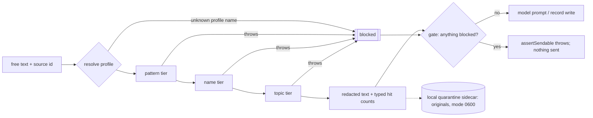

# Layered PII Redaction

> **Correction, 3 November 2026.** This is the first release README, kept as a record. Two of its claims no longer hold. An unknown source did not fail safe: it selected `standard`, which skips the unknown-name pass, so a mistyped source returned a note unchanged. Unknown sources now block. The evaluation numbers here are on the 182 development snippets, written before the rules changed and used as development data since. See the main [README](../README.md) for the current behavior and evidence.

A fail-closed, rule-based engine that removes personal identifiers from free text before it is sent to a model or written to a datastore.

> This is pattern-based PII redaction. It is not certified clinical de-identification. It has not been validated against any regulatory standard and should not be used as the only control for protected health information.

## Problem

Teams that summarize or mine unstructured text (clinical-style notes, patient messages, support tickets, chat exports) often need to send that text to a third-party model or a cloud store. The identifiers in it (names, phone numbers, record numbers, addresses) are the part that turns a later breach, log exposure or misconfigured bucket into harm to a specific person. Most of the useful content (the medication, the dose, the lab value) is not identifying. The job is to remove the first kind and keep the second, and to refuse to send anything when the redactor itself fails.

## How it works

Three tiers run in a fixed order. A per-source **profile** decides which tiers run.

| Tier | What it actually catches | How |
|---|---|---|
| **Pattern** (`src/patterns.js`) | Email; SSN (dashed, or labelled 9 digits); date of birth only when a birth marker (`DOB`, `born`, `date of birth`, `birthday`) sits right before the date; Luhn-valid card numbers; numbers after a label (`account`, `acct`, `routing`, `iban`, `member id`, `policy`, `mrn`, `medical record`); US phone numbers; decimal and degree GPS pairs; street addresses (number + 1 to 3 capitalized words + street suffix, optional unit and city/state/ZIP) | Regular expressions, typed tokens (`[phone]`, `[dob]`, `[account]`, …) |
| **Name** (`src/names.js`) | Known names from an injected people map → role tokens (`[patient]`, `[family]`). In `identifiers` and `strict`, also an unknown-name pass: honorific + name, runs of 2 to 3 capitalized words, and single capitalized words that are not at a sentence start and not on a short common-word list → `[name]` | Case-insensitive word matching; a capitalization heuristic, not named-entity recognition |
| **Topic** (`src/topics.js`) | Whole sentences about medical, legal, financial or child details → `[medical]`, `[legal]`, `[account]`, `[kid-detail]`. Under `standard` a personal marker (`my`, `I was`, `daughter`, a role token) must be in the sentence; under `strict` it need not be | Keyword lists over sentence spans |

| Profile | Tiers | Intended for |
|---|---|---|
| `light` | pattern; code spans exempt | source code, build logs |
| `standard` (default for unknown sources) | pattern, known names, topic (gated) | general free text |
| `identifiers` | pattern, known + unknown names; no topic tier | clinical-style notes: strip identifiers, keep clinical content |
| `strict` | pattern, known + unknown names, topic (ungated) | personal correspondence, where the topic itself is sensitive |



**Fail closed.** `redactText` returns `[redaction-blocked]` with `blocked: true`, never the input, when profile resolution, people-map normalization or any tier throws. It does the same for non-string input (a Buffer, an object), and for an explicit profile name that does not exist, so a typo cannot quietly select a weaker profile. The error carries the failing stage and error name only, not the message, because a custom tier could build its message from the input. Record helpers mark the whole record `blocked` if any field is blocked, and `assertSendable(gate)` throws so a writer cannot send it.

Only hit types and counts (`{ tier, type, count }`) travel with the redacted record. When text changes, the originals go to a local quarantine file (directory `0700`, file `0600`) so an operator can audit what was removed.

## Evidence

### Tests

`npm test`: **79 tests, 79 pass, 0 fail** (Node 24.14.1, run 2026-10-30).

- `test/redaction.test.js`: each tier, profiles, engine composition, quarantine files, people-map loading, the gate.
- `test/tripwire.test.js`: a synthetic PII corpus must not survive to the model prompt, the record, or the update body under each profile; re-redaction is a no-op; code spans pass through byte-identical under `light`; every declared sensitive source resolves to `identifiers` or `strict`; under `identifiers` a note loses its identifiers and keeps `metformin 500 mg BID`, `A1c 7.4%` and `BP 138/84`.
- `test/fail-closed.test.js` (11 tests): injects a throwing pattern rule, a throwing people map, a throwing name entry, a throwing topic category, misspelled profile names, non-string input, a failure in one field of a record, and a failure at the writer surfaces. Each must produce `[redaction-blocked]`, leak none of the input's identifiers anywhere in the result, and make `assertSendable` throw. To check these tests can fail, I ran them against three mutated copies of the engine: rethrow instead of block (7 of 11 failed), pass non-strings through (2 failed), fall back to the default profile on an unknown name (1 failed).
- `test/eval.test.js`: integrity of the evaluation set (at least 150 snippets, every label found in its text, only fictional phone and email shapes) and of the scorer (every profile's output aligns for every snippet).

### Measured results

**Run 2026-10-30, `npm run eval`, 182 synthetic snippets** (85 clinical-style note fragments, 35 patient messages, 22 general free-text, 40 clinical-only hard negatives), 207 labeled identifiers, 227 labeled hard negatives. Node 24.14.1, macOS arm64, empty people map. Full output, including every miss and every false positive: [`eval/results.md`](eval/results.md); raw numbers: `eval/results.json`.

**Method.** I wrote the set (`eval/dataset.js`) after the engine code was final for this release, and changed no rule after seeing the results. It includes shapes I expected the engine to miss. Each redacted output is aligned back to its input to find exactly which characters were removed. A labeled identifier counts as caught only if every letter and digit in it was removed. "Partial" means some were. A hard negative counts as damaged if any of its characters were removed. Precision is reported per emitted token, because tokens do not map one-to-one to labeled types (`[name]` covers people, relatives and facilities). Latency is one sample per `redactText` call: 200 rounds over all 182 snippets after 20 warm-up rounds, single process, nearest-rank percentiles.

| Profile | Identifiers fully removed | Partial | Span precision | Hard negatives kept | Clinical-only snippets untouched | p50 | p95 |
|---|---|---|---|---|---|---|---|
| `identifiers` | 70.5% (146/207) | 7 | 82.6% (190 spans) | 88.1% | 27/40 | 3.1 µs | 5.0 µs |
| `strict` | 74.4% (154/207) | 6 | 73.2% (213 spans) | 43.2% | 16/40 | 4.4 µs | 6.5 µs |
| `standard` | 33.3% (69/207) | 0 | 97.1% (69 spans) | 97.8% | 40/40 | 3.4 µs | 5.0 µs |
| `light` | 30.0% (62/207) | 0 | 100.0% (62 spans) | 100.0% | 40/40 | 2.2 µs | 3.3 µs |

`standard` and `light` do no unknown-name detection by design, and the empty people map gives them no known names, so their low recall here is expected. `strict` gets slightly higher recall than `identifiers` only because it deletes whole medical sentences, which costs it more than half of the clinical content.

**`identifiers` profile, by labeled type:**

| Type | Count | Fully removed | Partial | Missed | Recall |
|---|---|---|---|---|---|
| NAME | 51 | 43 | 4 | 4 | 84.3% |
| RELATIVE | 26 | 21 | 1 | 4 | 80.8% |
| FACILITY | 21 | 20 | 1 | 0 | 95.2% |
| DOB | 11 | 10 | 0 | 1 | 90.9% |
| DATE (visit, admission, other) | 25 | 0 | 0 | 25 | 0.0% |
| AGE | 14 | 0 | 0 | 14 | 0.0% |
| PHONE | 19 | 19 | 0 | 0 | 100.0% |
| EMAIL | 8 | 8 | 0 | 0 | 100.0% |
| ADDRESS (incl. GPS, PO box) | 13 | 12 | 1 | 0 | 92.3% |
| ID (MRN, SSN, member, account, card, license) | 19 | 13 | 0 | 6 | 68.4% |

**`identifiers` profile, by emitted token:** `[name]` 128 spans, 95 on real identifiers, 33 false positives (74.2% precision). Every pattern token (`[phone]` 19, `[address]` 11, `[dob]` 10, `[account]` 9, `[email]` 8, `[ssn]` 3, `[card]` 1, `[coords]` 1) was 100% precise on this set.

**`identifiers` profile, hard negatives kept intact:** doses 39/39, vitals 9/9, labs 49/50, clinical terms 44/47, drug names 49/63, other (section headers, versions, gestational age) 10/19.

### Known misses (`identifiers` profile, all 61 listed in `eval/results.md`)

- **Dates other than date of birth: 25 of 25 missed.** No rule covers visit, admission, discharge, procedure or appointment dates.
- **Ages: 14 of 14 missed.** No age rule (`72 y/o`, `54-year-old`, `Age: 86`, `101`).
- **IDs without a recognized label: 6.** `Member ID W123456789` (letter prefix), `Patient ID 7782194`, `MRN#: 30019487` (`#:` is not accepted), `member number 4500 1123 9987`, a group number, a driver license number.
- **Single names after a comma or at a sentence start: 7**, plus 1 lowercase name. `daughter, Rosa,`, `husband, Dev,`, `partner, Alexei.`, `brother, Kwame,`, `Thanks, Omar`, `Thanks again, Fatima!`, `Carlos sent…`, and `tanya`. The unknown-name pass treats a capital after a comma or a period as an ordinary sentence start.
- **Partial names: 5.** The surname after a middle initial survives (`John Q. Sample` → `[name] Q. Sample`), and the second half of hyphenated surnames survives (`Iturbe-Klein`, `Okonkwo-Baptiste`, `Vasquez-Moore`, `Nakamura-Boyd`).
- **Other partials: 2.** `St. Brendan Medical Center` keeps `St.`. `PO Box 4471, Springfield, MO 65801` loses only `Box`.
- **DOB with a verb between marker and date: 1.** `her date of birth is 2/14/1970`.

### Known false positives (`identifiers` profile, all 33 listed in `eval/results.md`)

- **Capitalized brand drug names mid-sentence: 14** (`Ozempic`, `Eliquis`, `Lexapro`, `Tylenol`, `Benadryl`, `Zoloft`, `Humira`, `Zofran`, `Keytruda`, `Humalog`, `Keflex`, `Pfizer`, `Xarelto`, `Entresto`). Lowercase generic names survived.
- **Section headers, form labels and other capitalized words: 15**, including `Chief Complaint`, `Present Illness`, `Hospital Course`, `Physical Exam`, `Sex`, `Age`, `Phone`, `Patient`, `Cardiology`.
- **Eponyms: 4** (`Crohn`, `Graves`, `Glasgow Coma Scale`, `Pap`). Others (`Hashimoto`, `Parkinson`, `Bell`, `Wilms`) survived only because they happened to sit at a sentence start or after a comma.
- A capitalized verb at a sentence start can be swept into a name run (`Started Eliquis`, `Prescribed Lexapro`).

All of these could be reduced with a domain safe list, which the engine supports. I did not add one, because one tuned against this set would make the numbers above meaningless.

## Design decisions and tradeoffs

- **Block on error, not pass through.** A redactor that throws gets caught by a writer's generic error handler, and the raw text may then go out anyway. Returning a blocked placeholder plus a `blocked` flag the gate enforces keeps the failure path as safe as the success path. The cost: a bug in one rule stops all traffic for that profile until it is fixed.
- **Deterministic rules, no model in the redaction path.** Results are reproducible, latency is single-digit microseconds per snippet, and no text leaves the process to be redacted. The cost is the recall ceiling shown above: rules do not understand context, so dates, ages and unlabeled IDs need explicit rules, and capitalized clinical vocabulary gets over-redacted.
- **A separate `identifiers` profile for clinical-style text.** The topic tier protects personal correspondence by deleting whole sensitive sentences, which destroys clinical notes (43% of hard negatives kept under `strict`). `identifiers` drops that tier and keeps 88%.
- **Unknown sources default to `standard`, never `light`,** and declared sensitive sources must resolve to `identifiers` or `strict` (enforced by a test). Forgetting to classify a source over-redacts. It does not leak.
- **Typed tokens instead of a bare `[REDACTED]`.** `[phone]` and `[patient]` keep the text readable for a downstream model, make hit counts auditable, and are lowercase so no tier re-matches them (redaction is idempotent).

## Limits

- No rules for non-birth dates, ages, or IDs without a recognized label. See the misses above.
- Name detection is a capitalization heuristic. It misses lowercase names and names after commas, and it removes capitalized drug names, eponyms and headers.
- US-centric shapes only: phone numbers, SSNs, ZIP codes and street suffixes. English keyword lists.
- No rules for URLs, IP addresses, or device and vehicle identifiers. Text only: no images or scanned documents.
- The people-map loader is not fail-closed. A missing or unreadable map file falls back to an empty map with one stderr line, and the known-name pass then has nothing to match. The unknown-name pass and pattern rules are unaffected.
- Record helpers redact the named text fields (`firstUserMsg`, `lastAssistantMsg`, `operatorTurns[].text`, `assistantTail[]`, `turns[].text`, summary fields). Any other field on a record is copied as-is.
- A failed quarantine write does not block the (already redacted) record. It logs one stderr line.
- The evaluation set is synthetic, small (182 snippets) and written by one person. It measures behavior on these shapes, not on real clinical documentation.
- Tested on Node 24.14.1 only. `engines` says Node 22 or later because `npm test` passes a glob to `node --test`.

## Run locally

```bash
npm test        # 79 tests, no dependencies, no install step
npm run eval    # writes eval/results.md and eval/results.json
```

```js
import { redactText } from "./src/index.js";

const r = redactText(
  "Pt seen by Dr. Alvarez. DOB: 4/12/1958, MRN 40417733, cell 212-555-0147. Continue metformin 500 mg BID; A1c 7.4%.",
  { source: "clinical-note" } // → identifiers profile
);
// r.text    → "Pt seen by [name]. DOB: [dob], MRN [account], cell [phone]. Continue metformin 500 mg BID; A1c 7.4%."
// r.blocked → false
// r.hits    → [{ tier: "name", type: "name", count: 1 }, { tier: "pattern", type: "account", count: 1 }, …]
```

Known names come from an injected people map (`opts.peopleMap`). `data/redaction-people.json` ships empty. `data/people-map.example.json` shows the shape with synthetic entries. To use a map file without committing it, point `REDACTION_PEOPLE_PATH` at it. Set `REDACTION_QUARANTINE_DIR` to choose where quarantine files go (default `~/_redaction-quarantine`, which is gitignored by name).

```
src/
  index.js              Node entry: people-map loading, quarantine, re-exports
  engine.js             profile → tiers → redacted text + hits; fail-closed wrapper
  patterns.js           pattern tier
  names.js              name tier (known names + unknown-name heuristic)
  topics.js             topic tier
  profiles.js           profiles and the source → profile table
  sensitive-sources.js  sources that must resolve to identifiers or strict
  gate.js               the single chokepoint writers call; assertSendable
  writers.js            minimal model-prompt and record stand-ins for the tests
  quarantine.js         local-only originals, mode 0600
eval/
  dataset.js            182 labeled synthetic snippets
  score.js              alignment and scoring
  run.js                runs every profile, writes results.md / results.json
```

## Development history

Built in June 2026 as the privacy gate in front of every ingest path of my private personal-knowledge system, covering my own notes and transcripts, and maintained there through October 2026 over 24 changes. This repository is a cleaned standalone snapshot. The evaluation and the fail-closed fixes described above were added for this release in October 2026.

## License

MIT, Copyright (c) 2026 Kevin Madden. See `LICENSE`. All names, numbers, addresses, facilities and dates in this repository are fictional or synthetic.
